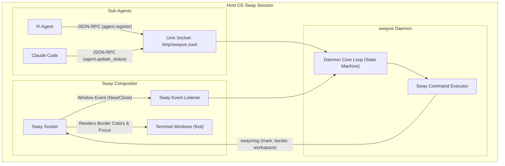

# swayve

> **Native Wayland Compositor Orchestration for Autonomous AI Agents**

`swayve` is an asynchronous Rust daemon and CLI tool that turns tiling window managers into high-performance, visual multi-agent IDE workspaces. By leveraging Sway's native Unix socket IPC, `swayve` integrates command-line agents (like Pi, Claude Code, and Aider) directly into the compositor's window tree as native, first-class window objects.

---

## 💡 The Rationale: Why Sway?

Traditional developer workflows attempt to squeeze multi-agent execution loops into nested terminal multiplexers (`tmux`, `zellij`) or heavy web-based grids. This introduces key limitations:
1. **Shortcut Collisions**: Nested keyboard prefixes clash with terminal tools and local editors.
2. **Resource Exhaustion**: Chromium-based Electron grid viewers consume excessive memory and lack native desktop navigation speed.
3. **No Process Isolation**: If a multiplexer server crashes, the entire workspace goes down.
4. **Lack of Ambient Feedback**: Web overlays cannot alter terminal boundaries to draw focus when an agent requires human attention.

**The Tiling Compositor Solution:**
By delegating window management directly to Sway/Wayland:
* **Native Isolation**: Every agent executes in an independent, lightweight terminal instance (`foot`), isolating processes at the OS level.
* **Ambient Status Borders**: The compositor automatically recolors window borders depending on agent states (e.g., Idle, Thinking, Awaiting Human Input).
* **Keyboard-Driven Focus**: Jump directly to the agent requesting input via global Sway bindsyms (`$mod+Shift+a`), skipping manual workspace navigation entirely.
* **Workspace Isolation**: Projects map natively to Sway workspaces (e.g., `proj:core-backend`), keeping workspaces organized and clean.

---

## 🏛 System Topology



---

## 📋 Prerequisites

To run `swayve` successfully, ensure the following are available on your system:
* **Sway Compositor**: Running Wayland compositor with active socket (`SWAYSOCK` env var populated).
* **Terminal Emulator**: A Wayland-native emulator supporting app ID overriding. By default, `foot` is configured, but any tool supporting a launch command template (e.g. `kitty`, `alacritty`) works.
* **Rust toolchain (cargo)**: Rust 1.70+ or cargo build chain for compiling the binary.
* **Network utilities**: `nc` (netcat) or `socat` for shell-based scripting if interacting manually.

---

## 🚀 Quick Start

### 1. Compile & Build
Ensure you have the Rust toolchain installed:
```bash
cargo build --release
```

### 2. Configure Sway
Place the following in your Sway configuration (typically `~/.config/sway/config` or `~/.config/sway/config.d/50-agent-viewer.conf`):

```sway
# Automatically group agent windows into tabbed containers
for_window [app_id="^agent\..*"] {
    layout tabbed
    border pixel 3
}

# Floating HUD / Orchestrator Panel configuration
for_window [app_id="agent.orchestrator"] {
    floating enable
    resize set width 900px height 600px
    move position center
    border pixel 2
    sticky enable
}

# Navigation Bindings ($mod = Super / Mod4)
# Quick-jump to the next agent requiring attention
bindsym $mod+Shift+a exec swaymsg '[con_mark="needs_attention"] focus'

# Step through agent windows in hierarchy order (each parent, then its children)
# Requires the daemon. Without it, cycling falls back to every Sway window in flat order.
bindsym $mod+a exec swayve focus --cycle

# Toggle HUD/Orchestrator Panel overlay
bindsym $mod+Shift+o exec swayve panel toggle

# Run the daemon on startup
exec_always --no-startup-id swayve daemon
```

### 3. CLI Command Reference

* **Start the Daemon:**
  ```bash
  swayve daemon [--dry-run]
  ```
  *(Running with `--dry-run` logs all Sway window operations to stdout instead of connecting to `SWAYSOCK`, useful for headless/offline testing)*

* **Spawn an Agent:**
  ```bash
  swayve spawn --wave refactor-auth --agent pi --project core-backend [--prompt "refactor auth"]
  ```
  *(Launches the agent's executable, optionally passing a startup prompt parameter automatically wrapped inside a shell execution context)*


* **Toggle Panel:**
  ```bash
  swayve panel toggle
  ```

* **View Active Agent Status:**
  ```bash
  swayve status [--json]
  ```

---

## ⚙️ Configuration (`~/.config/swayve/config.toml`)

Customize agent states, border styles, and terminal commands:

```toml
[border_colors]
idle = "#44475a"                 # Dracula comment (neutral)
thinking = "#ffb86c"             # Dracula orange
executing_tool = "#8be9fd"       # Dracula cyan
awaiting_human_input = "#ff5555" # Dracula red (alert)
completed = "#50fa7b"            # Dracula green
failed = "#ff79c6"               # Dracula pink

[terminal]
default_emulator = "foot"
args = [
    "--app-id", "{app_id}",
    "--title", "{title}",
    "-e", "{command}"
]
```

---

## 🛠 Project Structure

* [src/config.rs](file:///home/andrew/workspace/swayve/src/config.rs): Configuration loading and parser routines.
* [src/types.rs](file:///home/andrew/workspace/swayve/src/types.rs): Central data structures and JSON-RPC message framing schemas.
* [src/daemon.rs](file:///home/andrew/workspace/swayve/src/daemon.rs): Socket handling loop and state coordination engine.
* [src/sway.rs](file:///home/andrew/workspace/swayve/src/sway.rs): Event listener and serialized command execution threads interfacing with `swayipc-async`.
* [src/cli.rs](file:///home/andrew/workspace/swayve/src/cli.rs): Main subcommand handler mappings (`daemon`, `spawn`, `panel`, `status`).
* [tests/integration_tests.rs](file:///home/andrew/workspace/swayve/tests/integration_tests.rs): Fully automated test suite validating registration and status updates.

---

## 🔍 Troubleshooting

### 1. `swayve` fails to connect to Sway
* **Symptoms**: `Error: SWAYSOCK environment variable not set, and dry-run is disabled.`
* **Solution**: Ensure the daemon is launched *inside* your Sway session (e.g. via Sway's `exec` startup configs). If testing manually from a dry terminal, execute with the `--dry-run` flag or prefix with `SWAYVE_DRY_RUN=1`.

### 2. Window borders are not recoloring
* **Symptoms**: Agents spawn successfully but borders remain at their default themes.
* **Solution**:
  1. Ensure your terminal app ID matches the expected patterns (`for_window [app_id="^agent\..*"]`).
  2. Verify that the agent successfully registers with `swayve spawn` and has an active mark assigned (verify via `swaymsg -t get_tree | grep mark_`).

### 3. Verification of agent app IDs
* **Symptoms**: Sway layout rules are not applying to spawned terminals.
* **Solution**: Run `swaymsg -t get_tree` while the agent terminal is active and inspect the container's `app_id` attribute. Ensure the template arguments in `~/.config/swayve/config.toml` correctly target the emulator's corresponding application flag.

