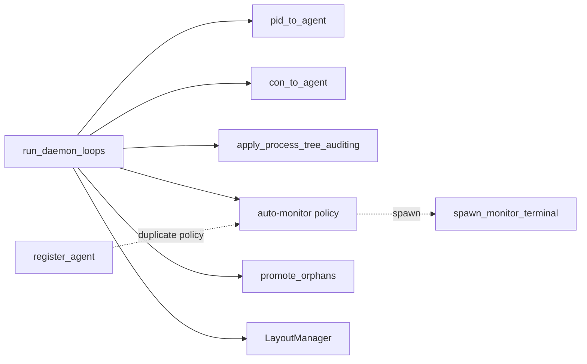

# Architecture review: swayve

Date: 2026-11-08

Legend: a box is a module, a dashed line is a seam, a red label is leakage, a dark block is a deep module.

## 1. Pull Sway window lifecycle into DaemonState

**Strength:** Strong · **Category:** in-process

**Files:** `src/daemon.rs` (`run_daemon_loops` Sway arm, `register_agent_window`, `promote_orphans`, `apply_process_tree_auditing`, `spawn_monitor_terminal`), `src/layout.rs` (`LayoutAction`)

**Before:** the event loop is shallow. It does registry bookkeeping, orphan promotion, and auto-monitor policy inline.



**After:** one deep interface.

```
DaemonState
  on_window_created(con_id, app_id, pid)
  on_window_destroyed(con_id)
  internal: pid map, con map, orphan promotion, auto-monitor decision
  returns: Vec<LayoutAction>, Vec<MonitorRequest>
  the loop only executes the spawn
```

**Problem:** the auto-monitor rule exists twice, in `register_agent` and in the WindowCreated arm. Its side effect, spawning a terminal, runs inside state, so `test_auto_monitor_subagent_registration` only checks that the agent was inserted. Window rules are reachable only through channels.

**Solution:** give `DaemonState` two window methods that return values: a layout action and a monitor request. The loop only executes the spawn.

**Wins:**
- locality: window rules and the auto-monitor rule live in one place
- leverage: two methods cover the window lifecycle
- tests call state directly, with no socket or channel

## 2. Give the process-tree walk a parent-lookup seam

**Strength:** Worth exploring · **Category:** local-substitutable

**Files:** `src/daemon.rs` (`get_parent_pid`, `find_registered_parent_ancestor`, `test_early_termination_at_depth_limit`)

**Before:** `/proc` is read in place. `test_early_termination_at_depth_limit` starts at PID 1 and asserts `None`, so it passes even if `max_depth` is ignored.

**After:** `find_registered_parent_ancestor(pid, parent_of: impl Fn(u32) -> Option<u32>, …)`. Production passes a `/proc` adapter; the test passes a map-backed fake.

**Problem:** the walk cannot be tested without a live process tree, so the max-depth guard has no working test.

**Solution:** pass the parent lookup as a closure.

**Wins:**
- locality: `/proc` format knowledge sits in one function
- the depth limit becomes checkable

**Caveat:** there is one production adapter. The seam is justified only by the test fake, which is the second adapter.

## 3. One module owns the status diff wire shape

**Strength:** Worth exploring · **Category:** in-process

**Files:** `src/daemon.rs` (`broadcast_status`, `broadcast_diff`, `SubMode`), `src/cli.rs` (`fold_diff_line`, `run_status_watch`)

**Before:** the daemon writes a `json!` literal of `{snapshot, upsert, remove}`, and the CLI reads it with raw `Value` indexing. There is no shared type.

**After:** a `DiffFrame { snapshot, upsert, remove }` type, `Serialize` and `Deserialize`, with `fold(&mut map, frame)`. The daemon builds frames and the CLI folds them.

**Problem:** a change to the diff format has to be made in two files with no compiler help.

**Solution:** move the frame into a small shared module that both sides use.

**Wins:**
- locality: the diff schema lives in one place
- leverage: the fold rule is testable without a socket

## 4. Name the focus cycle as a module

**Strength:** Speculative

**Files:** `src/daemon.rs` (`last_focused` local in `run_daemon_loops`, `next_focus_target`), `src/cli.rs` (`next_flat_agent_index`, `focus_cycle_standalone`, the fallback under ADR 0003)

**Before:** focus state is a local variable beside the registry it reads. The rule is a free function.

**After:** `FocusCycle { last }` with `.next(&agents)` and `.observe(con_id)`.

**Problem:** the algorithm is already pure and tested (`test_hierarchical_focus`, `test_focus_cycles_between_roots`).

**Solution:** move the cursor into a small struct. Keep the CLI flat fallback as it is.

**Deletion test:** removing `next_focus_target` would scatter the rule, but the rule is already one function, so the gain is small. Do not merge the daemon and CLI paths; ADR 0003 accepts the flat fallback.

## 5. Extract the spawn plan from the CLI match arm

**Strength:** Worth exploring · **Category:** pure logic

**Files:** `src/cli.rs` (`Commands::Spawn` arm). Only the first ~40 lines of this arm were read.

**Before:** prompt escaping, `bash -c` wrapping, and clock-derived IDs run inside the match arm, so no test reaches them.

**After:** `spawn_plan(args, now_ms) -> SpawnPlan`, a pure function. The arm executes the plan.

**Solution:** make the plan a value, with the clock passed in.

## Top recommendation

**Candidate 1, Pull Sway window lifecycle into DaemonState.** It has the most leverage. Window rules are reachable only through channels today, and the auto-monitor rule is duplicated where a fix could easily miss one copy. No ADR conflicts with it. It keeps ADR 0005's command-plan shape, since the methods return `LayoutAction` values.

Which of these would you like to explore?
