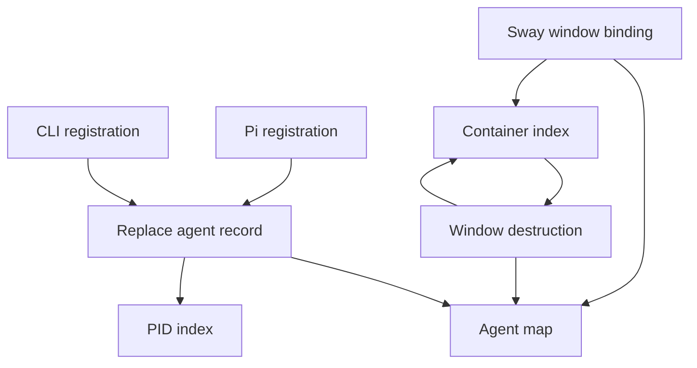
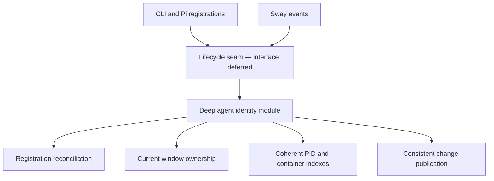
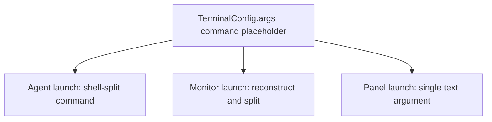
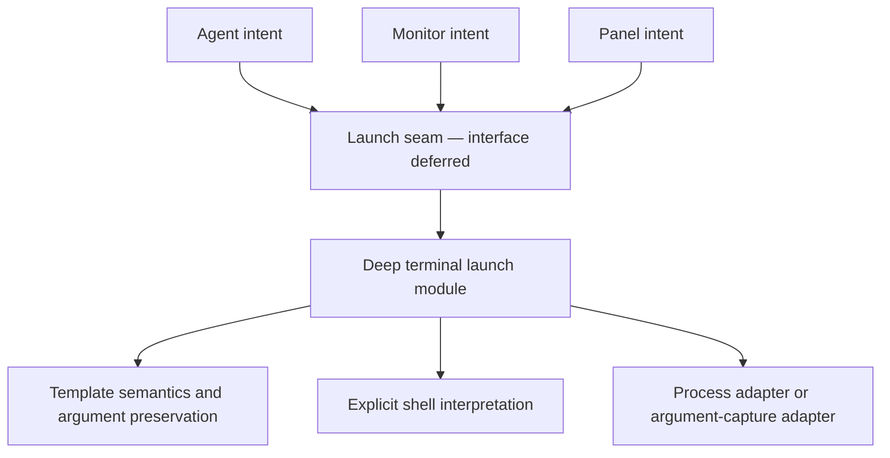
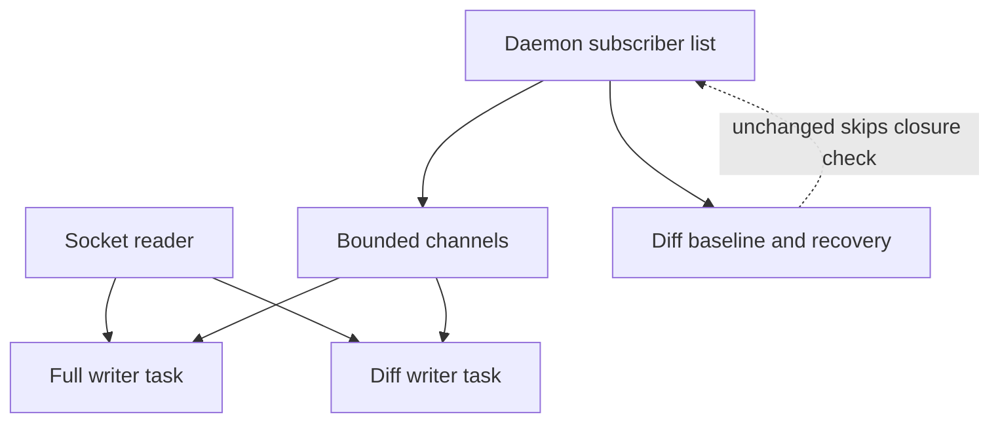
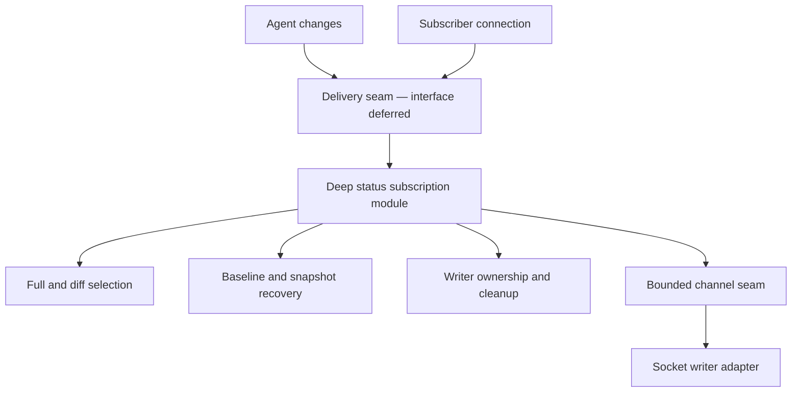

# Architecture review: swayve — follow-up

Date: 2026-11-08  
Reviewed HEAD: `17c72ce`  
Method: static source tracing and test inspection; tests were not executed.

No `CONTEXT.md` exists. Domain terms follow source and accepted ADRs in `docs/decisions/`. The earlier review's candidates are implemented (G54–G71); this review identifies current opportunities rather than repeating those extractions. Concrete interfaces are deliberately deferred.

## 1. Deepen agent identity and window ownership

**Recommendation strength:** Strong  
**Category:** in-process

**Files:** `src/daemon.rs`, `src/cli.rs`, `integrations/pi/src/swayve-client.ts`, `tests/integration_tests.rs`, `tests/spawn_register.rs`

### Before

### After

**Problem:** The registry interface exposes independently mutable records and indexes; repeated registration and rebinding can break ownership while publication remains a caller obligation.

**Solution:** Deepen the existing agent lifecycle module so its implementation owns reconciliation, index invariants and change publication—not just event-method extraction.

**Benefits:**

- Locality: ownership rules stay together.
- Leverage: all event producers benefit.
- Depth: callers stop coordinating indexes.

**Tests through the interface:** Exercise registration → binding → re-registration, rebinding → old-window close, and binding → subscriber observation; assert registry and stream coherence.

### Evidence

- `src/daemon.rs:152–163` replaces the record with no container and Idle status; old reverse associations are not reconciled.
- `src/daemon.rs:642–647,244–254` binding keeps older container associations; destruction trusts the association and removes the agent.
- `src/cli.rs:545–547` derives a dotted app_id; `integrations/pi/src/swayve-client.ts:61–71` re-registers the same agent with a differently derived app_id.
- `src/daemon.rs:574–589` publishes destruction, not creation/binding. Existing subscribers can miss the new container until a later broadcast.

**Deletion test:** Removing cohesive ownership would scatter these invariants across registration, binding, destruction, focus and publication. Deleting a pass-through module would not solve them.

**Seam / adapter discipline:** CLI and Pi are real registration producers; Sway is a real event adapter. No interchangeable registry adapter is demonstrated, so do not add a generic registry-backend seam.

**ADR alignment:** Preserves ADR 0003 daemon ownership, ADR 0005 command plans, ADR 0006 app_id identity, and ADR 0009 thin clients. No ADR reopening required.

## 2. Give terminal launch semantics one home

**Recommendation strength:** Strong  
**Category:** local-substitutable

**Files:** `src/cli.rs`, `src/daemon.rs`, `src/config.rs`, `tests/integration_tests.rs`

### Before

Each caller learns quoting and argument rules.

### After

**Problem:** Three callers interpret the same terminal configuration differently; pure agent planning alone does not give terminal argument rules locality.

**Solution:** Concentrate template expansion and argument preservation in one deep terminal launch module; keep terminal-specific execution details behind its seam.

**Benefits:**

- Locality: one quoting implementation.
- Leverage: three launch callers benefit.
- Depth: interface hides argv mechanics.

**Tests through the interface:** Capture exact argument arrays for all three launches; cover whitespace paths, quoted prompts and explicit shell templates without starting Sway.

### Evidence

- `src/config.rs:111–120` defaults to separate `-e` and `{command}` arguments.
- `src/cli.rs:550–560` expands command text to multiple arguments; `src/cli.rs:350–361` passes `swayve status --watch` as one argument.
- `src/daemon.rs:267–285` interpolates the log path into unquoted command text and splits it; whitespace in the path changes argument grouping.
- `tests/integration_tests.rs:898–903,985–1000` uses `echo "$@"` and substring assertions, losing the argument distinctions that matter.

**Deletion test:** Deleting the shared semantics would force all three callers to reconstruct them; merely moving process spawning would be shallow.

**Seam / adapter discipline:** Actual process execution and an argument-capture executable are two useful adapters. Additional terminal-emulator adapters remain hypothetical.

**ADR alignment:** Preserves ADR 0006 identity and ADR 0010 configuration. Does not reopen pruned G65 monitor environment parity. Existing spawn-plan extraction is retained, not re-proposed.

## 3. Deepen subscription lifetime ownership

**Recommendation strength:** Worth exploring  
**Category:** local-substitutable

**Files:** `src/daemon.rs`, `src/cli.rs`, `tests/slow_consumer.rs`, `tests/subscribe_golden.rs`

### Before

### After

**Problem:** Subscription state and detached writer lifetimes need coordinated cleanup; unchanged diff delivery can retain a subscriber whose channel is already closed.

**Solution:** Give a deep subscription module ownership of delivery state and connection lifetime, preserving both existing wire formats and overflow policies.

**Benefits:**

- Locality: cleanup meets delivery state.
- Leverage: both subscription modes benefit.
- Depth: interface hides lifetime coordination.

**Tests through the interface:** Add unchanged-state disconnect, repeated subscription and writer cleanup cases; retain existing overflow and slow-consumer convergence tests.

### Evidence

- `src/daemon.rs:107–108,122–134` returns on unchanged diff state before attempting the send that detects a closed channel.
- `src/daemon.rs:463–497` duplicates detached writers across subscribe modes; the reader and writer have separate lifetimes.
- `src/daemon.rs:611–617` broadcasts globally when adding a subscriber; `src/cli.rs:593–614` opens fresh subscriptions while waiting for registration.
- `src/daemon.rs:1186–1283` and `tests/slow_consumer.rs:40–170` already cover overflow/recovery; this is not an untested subsystem.

**Deletion test:** Removing delivery ownership would spread baseline, overflow and cleanup knowledge across transport and registry callers. Deduplicating writer loops alone adds little depth.

**Seam / adapter discipline:** Bounded channels permit deterministic delivery tests; the Unix-socket writer is the real transport adapter. No second transport adapter justifies a pluggable messaging seam.

**ADR alignment:** Preserves ADRs 0008 and 0013: full-list compatibility, per-subscriber diff baselines, and snapshot recovery. The shared `DiffFrame` is already implemented. No new resync protocol.

## Top recommendation

**Agent identity and window ownership.** Start here: existing lifecycle methods still leave load-bearing ownership invariants exposed, so greater depth pays back across registration, layout, focus and status observation.

Which of these would you like to explore?
